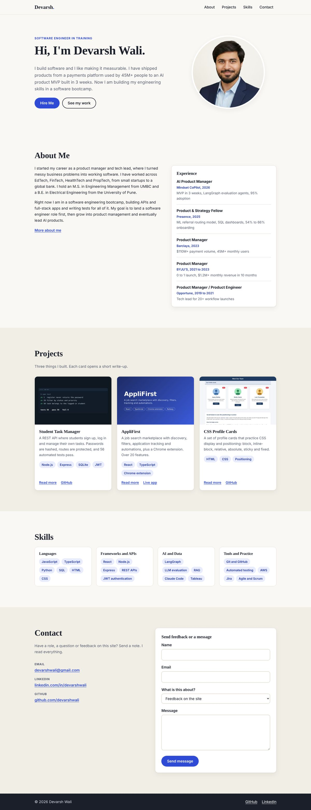
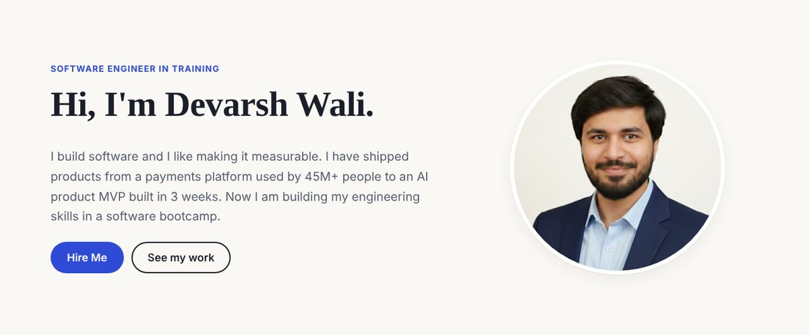
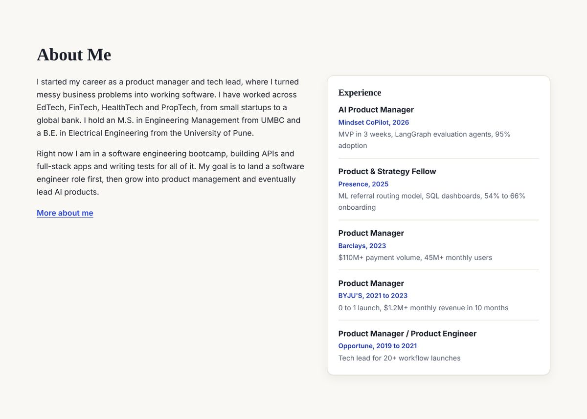
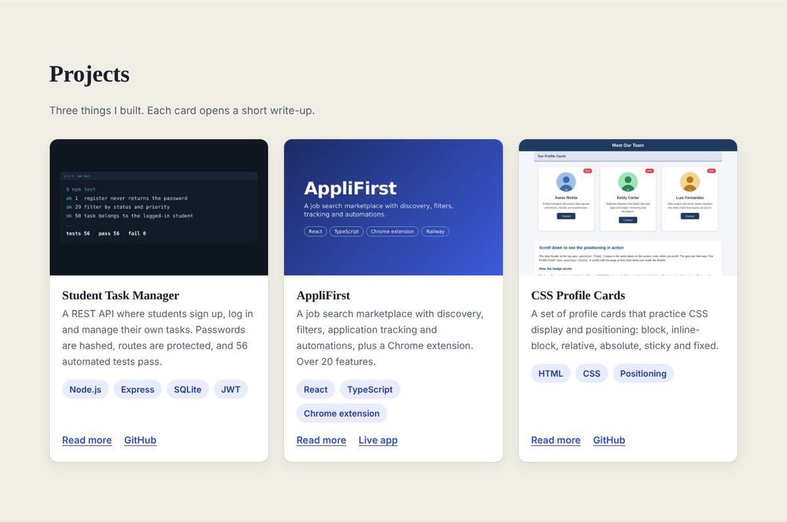
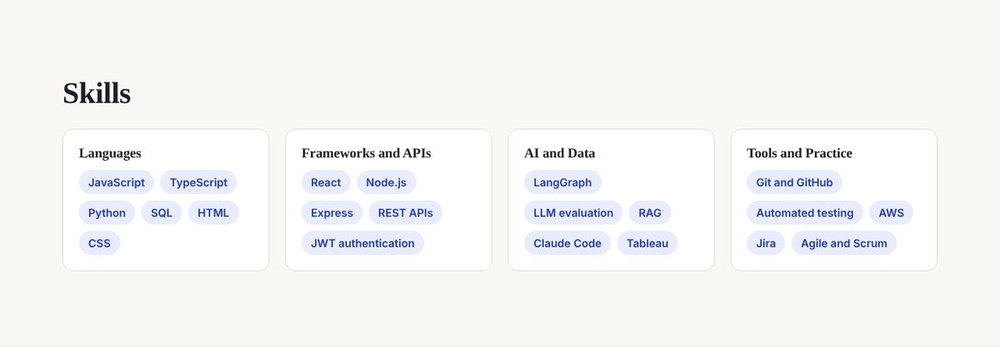
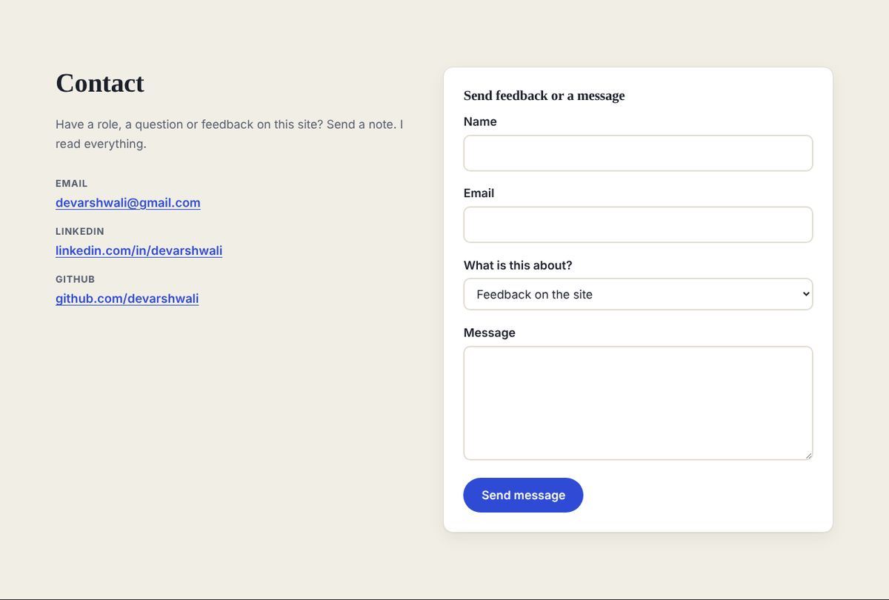
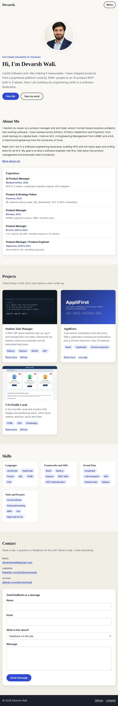
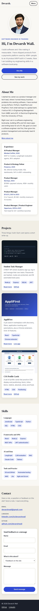
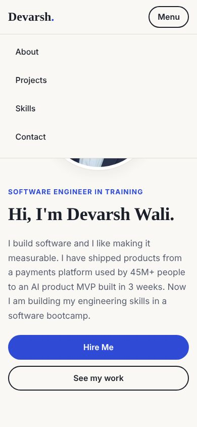
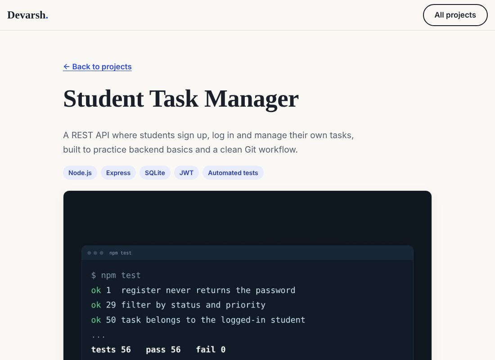

# Personal Portfolio Website

A responsive, single-page portfolio for Devarsh Wali. Built with plain HTML, CSS and JavaScript. No frameworks, no build step.

## Overview

The site introduces who I am, shows three projects, lists my skills and gives visitors a way to reach me. It works on phones, tablets and desktops.

Sections: Header and navigation, About Me, Projects, Skills, Contact.

## Features

- Semantic HTML (`header`, `nav`, `main`, `section`, `article`, `figure`, `form`, `footer`)
- Responsive layout with CSS Grid, Flexbox and media queries
- Mobile menu button that opens and closes the navigation
- **Hire Me** button that shows an alert
- **More about me** toggle that shows and hides extra text
- Contact form with validation for name, email and message, plus a topic dropdown
- Three project write-ups in the `projects/` folder
- Skip link, visible focus styles and labelled form fields for accessibility
- Passes the W3C Nu HTML and CSS validators with no errors or warnings

## Project structure

```
personal-portfolio-website/
├── index.html          Main page
├── style.css           All styles and media queries
├── script.js           All interactions
├── images/             Profile photo and project images
├── projects/           One page per project
│   ├── task-manager.html
│   ├── applifirst.html
│   └── css-profile-cards.html
├── screenshots/        Screenshots used in this README
└── README.md
```

## Setup instructions

No installation is needed.

1. Clone the repository:
   ```bash
   git clone https://github.com/devarshwali/personal-portfolio-website.git
   cd personal-portfolio-website
   ```
2. Open `index.html` in any browser.

To run it from a local server instead:

```bash
python3 -m http.server 8000
```

Then visit `http://localhost:8000`.

## How the contact form works

The site has no server. When a visitor submits a valid form, the message opens in their email app, addressed to me and ready to send.

## Screenshots

### Full page, desktop



### Sections

| Hero | About |
| --- | --- |
|  |  |

| Projects | Skills |
| --- | --- |
|  |  |



### Tablet



### Mobile

| Full page | Menu open |
| --- | --- |
|  |  |

### Project page



## Testing

- Checked at 320px, 390px, 820px and 1440px wide. No horizontal scrolling at any size.
- Clicked through every interaction: Hire Me, More about me, the mobile menu and each form error case.
- No errors or warnings in the browser console.
- HTML and CSS validated with the W3C Nu validator.

## Author

Devarsh Wali

- Email: devarshwali@gmail.com
- LinkedIn: [linkedin.com/in/devarshwali](https://www.linkedin.com/in/devarshwali/)
- GitHub: [github.com/devarshwali](https://github.com/devarshwali)
